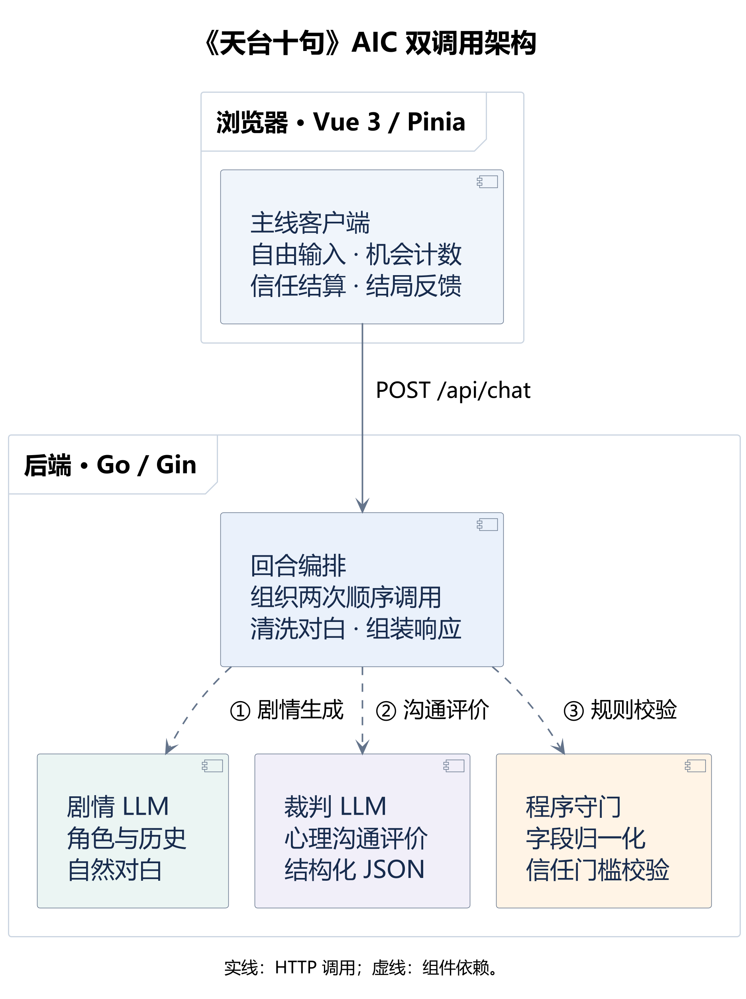
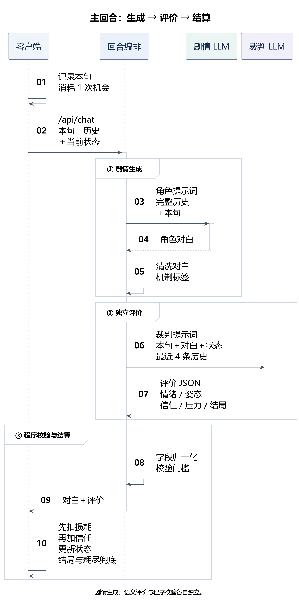

# 天台十句｜只有十句话，你会怎样开口？

> 面对困境中的人，仔细斟酌说出的每一句话。

《天台十句》是一款以 **AI 原生交互与心理健康沟通学习为核心玩法的短篇叙事游戏**。玩家在雨后的学校天台遇见大学生“艾”，只有十句话的机会。你需要自由输入、亲自组织回应；AI 理解上下文、生成对白、依据心理健康沟通行为参与结局裁判，并在局后复盘验证、倾听、选择权和现实支持连接，让每句话都成为有后果的游戏操作。

当前文档对应 **`AIC` 独立项目**，更新于 2026-10-29。试玩地址：http://tiantaishiju.top 。

## 为什么是十句话

当艾说“说了也没人听”，你准备接着说什么？有限机会让玩家在发送前停一下：这句话是否回应了她的经历，是否急着替她下结论，是否给她留下继续说的空间？自由输入让选择属于玩家，状态反馈让玩家观察回应，再调整下一句。

作品希望观众关注困境中的人，思考怎样认真听、怎样具体回应。紧张、犹豫和表达构成游戏体验；它没有一套保证通关的安慰台词，也不把十句规则当作现实支持的期限。

## AI 原生机制：让自由语言进入游戏规则

**自由输入 → 角色模型回应 → 独立 JSON 裁判 → 前后端程序守门 → 对白 / 状态 / CG / 结局反馈。**

- **表达即操作**：玩家自己组织语言，语义判断进入信任与状态结算。
- **十句即资源**：每次有效发送固定消耗一次机会，促使玩家斟酌，也约束单局交互规模。
- **职责拆分与规则守门**：自然对白和结构化判定分开，程序校验结局条件，使生成内容进入可收束的流程。
- **心理健康沟通反馈**：提示与复盘使用创伤知情、心理急救（PFA）和动机式访谈（MI/OARS）的可观察行为规则，不给角色或玩家下临床诊断。
- **模型条件反推形式**：固定场景、短对白与等待节奏收敛交互规模，客户端等待状态承接模型调用节奏。
- **反馈承载立意**：语言引发的变化让“怎样回应”成为可玩的选择。完整论证见[创新机制](docs/engineering/innovation_mechanism.md)。

## 技术架构创新：生成与评价的双调用链路

AIC 版把一次玩家输入拆成两个职责明确、顺序执行的 LLM 调用，再交给确定性程序结算：

1. **剧情 LLM（Role / Actor）**只负责依据角色事实、对话历史和玩家本句生成艾的自然对白。它不输出信任度、情绪标签、JSON 或结局标记，避免把叙事文本和机制判定混在同一响应里。
2. **裁判 LLM（Judge / Evaluator）**接收玩家本句、剧情 LLM 的对白、最近历史和当前状态，依据心理健康沟通 rubric 输出结构化 `evaluation` JSON，判断情绪、姿态、信任变化、压力变化和结局候选。
3. **程序规则守门（Deterministic Gate）**对 JSON 做字段归一化、信任结算、低信任离开拦截和机会耗尽兜底。模型可以提出候选结局，但不能绕过程序门槛。
4. **复盘 LLM**在结局后独立生成关键转折、心理沟通观察、支持技能、下一步和安全边界；它只描述可观察的语言行为，不给玩家或角色下临床诊断。

这种“生成—评价—守门—复盘”架构带来三个工程收益：剧情输出可以保持自然，裁判输出可以被 JSON 契约和单元测试审计，结局规则可以在模型不稳定时 fail closed。它不是两个模型互相证明真相；角色和裁判也可以使用同一服务商，职责隔离才是核心。

### UML 架构图（PlantUML）

仓库提供两张可编辑的 UML 源图，使用 PlantUML 渲染：

- [组件图：客户端、回合编排、剧情 LLM、裁判 LLM 与程序守门](docs/architecture/aic_dual_call_component.puml)
- [时序图：主回合的剧情生成、独立评价与程序结算](docs/architecture/aic_dual_call_sequence.puml)

组件图展示主回合的组件依赖，时序图展示两次模型调用与前后端结算的先后关系。剧情与裁判使用同一份模型配置，通过各自的 Prompt 和响应契约区分职责；离开行动由裁判按叙事判断，信任门槛由程序校验。提示、复盘与安全回访通过独立 API 入口调用。

#### 组件图



[查看 SVG 矢量版](docs/architecture/aic_dual_call_component.svg) · [查看 PlantUML 源码](docs/architecture/aic_dual_call_component.puml)

#### 时序图



[查看 SVG 矢量版](docs/architecture/aic_dual_call_sequence.svg) · [查看 PlantUML 源码](docs/architecture/aic_dual_call_sequence.puml)

两组图在本地使用微软雅黑生成，PNG 以三倍分辨率导出，SVG 将文字固定为字形轮廓。[UML 图维护与字体规范](docs/architecture/README.md)包含生成环境、导出命令及窄屏验收方法。

## 当前 AIC 版规则与功能

- 大学生艾，承受学业压力、网络嘲讽、家庭期待与孤独；故事通过对话逐步展开。
- 每局最多 10 次有效发送，每次消耗 1 次机会，不返还、不额外扣句数；初始提示 3 次。
- 信任 0—15，正向增量为 5，压力损耗信任。信任是游戏反馈，不是现实心理测量。
- 两个结局：**安全离开 / 拒绝离开**。安全离开需要本轮结算信任达到 15，且 AI 判定叙事条件成立；满分或哭泣不自动成功。
- 安全离开播放预制“落泪—抹泪—一起进入楼梯间”三段 CG，可跳过或重看，随后进入微信式后日谈。
- 本地三栏位主线/后日谈存档、成就、心理健康沟通提示及带技能标注的结局复盘。

当前项目边界包含大学生艾、雨后天台、固定十句话、双调用裁判、两个结局、心理健康沟通提示和局后复盘。

## 技术栈

```text
backend/     Go 1.22 + Gin + OpenAI-compatible / Anthropic Messages
legacy_vue/  Vue 3 + Vite + TypeScript + Pinia + Tailwind CSS + Howler
docs/        产品、技术、Prompt 与优化文档
```

## 本地运行

### 环境要求

- Go 1.22+
- Node.js 24（当前验证环境；旧版 Node 20 不一定满足锁定依赖的要求）

### 启动后端

```bash
cd backend
cp .env.example .env
go mod download
go run .
```

后端默认运行在 `http://localhost:8080`。

后端 `.env` 可配置服务器侧兜底模型。玩家未在前端填写自己的 API Key 时，后端会使用服务器侧配置；`.env` 不应提交到 GitHub。

### 启动前端

```bash
cd legacy_vue
npm ci
npm run dev
```

前端默认运行在 `http://localhost:5173`，Vite 会将 `/api/*` 转发到本地 `http://127.0.0.1:8080`，无需额外配置。后端地址或端口不同时，可通过 `legacy_vue/.env.local` 覆盖：

```env
VITE_BACKEND_URL=http://localhost:8080
```

## 项目结构

```text
.
├── backend/                  # Go 后端与 LLM 转发层
│   ├── config/               # 环境变量与运行配置
│   ├── handlers/             # HTTP API
│   ├── llm/                  # Provider 适配与 Prompt 保护
│   └── main.go
├── legacy_vue/               # 当前主前端
│   ├── public/               # 游戏美术、音频与静态资源
│   └── src/
│       ├── components/       # 通用 UI 组件
│       ├── modules/          # LLM、音频、存档、成就模块
│       ├── router/           # 页面路由
│       ├── store/            # Pinia 状态
│       └── views/            # 页面视图
├── docs/                     # 项目文档
│   └── architecture/         # PlantUML UML 组件图与时序图
└── README.md
```

## 文档导航

文档入口：[docs/README.md](docs/README.md)

- [AI 原生机制创新论证](docs/engineering/innovation_mechanism.md)
- [项目简介与 AI 原生说明](docs/product/project_overview.md)
- [玩家阅读文档](docs/product/player_guide.md)
- [故事线与世界观](docs/product/storyline_and_lore.md)
- [游戏设定集](docs/product/game_setting_bible.md)
- [技术文档](docs/engineering/technical_overview.md)
- [AIC Prompt 与 AI × 心理健康沟通规范](docs/engineering/prompts_and_settings.md)
- [项目状态与待办](docs/STATUS.md)
- [AIC 独立项目说明](docs/submission/project-aic.md)
- [AIC 独立项目变更记录](docs/submission/change-log-aic.md)

## 参考文献与架构启发

心理健康沟通部分参考 WHO 的心理急救（PFA）和 SAMHSA 的创伤知情原则；Agent 架构部分参考多智能体系统中的职责分离、过程评价和反馈闭环。以下文献用于说明设计来源，不表示本项目复现了论文中的训练算法或实验结论。

1. World Health Organization. *Psychological first aid: Guide for field workers*. 2011. [WHO 官方页面](https://www.who.int/publications/i/item/9789241548205)。本项目借用“观察—倾听—连接”的沟通边界。
2. Substance Abuse and Mental Health Services Administration. *Interagency Task Force on Trauma-Informed Care*. [SAMHSA 官方页面](https://www.samhsa.gov/mental-health/trauma-violence/trauma-informed-care)。本项目将安全、信任与透明、选择、协作和赋能转译成 Prompt 约束。
3. Tang, Z. (2025). *Evaluation-Driven Intelligence: From Visual Captioning Metrics to Agentic Workflow Optimization*. The Hong Kong University of Science and Technology, MPhil thesis. [HKUST Research Portal](https://researchportal.hkust.edu.hk/en/studentTheses/evaluation-driven-intelligence-from-visual-captioning-metrics-to-/) · [DOI](https://doi.org/10.14711/thesis-hdl167771)。该工作提出 evaluator feedback 驱动的 Agent 工作流，并以 dual-LLM trainer 分离全局 critic 与局部 prompt editor；AIC 将这一思想落实为剧情 LLM、裁判 LLM 和规则守门的职责分离。

## 常用命令

```bash
# 前端测试
cd legacy_vue
npm test -- --run

# 前端构建
npm run lint
npm run build

# 后端构建
cd ../backend
go test ./...
go build ./...
```

## 隐私与安全

- 玩家填写的 API Key 持久化在浏览器 `localStorage`，请求时会发送给本项目后端，再由后端调用所选服务商；并非“不会离开浏览器”。部署应使用 HTTPS，勿导出或提交真实密钥。
- 服务器侧兜底 API Key 只通过后端环境变量读取，不暴露给前端。
- 游戏存档和成就均保存在本地浏览器。

## 当前状态

当前版本已完成标题页、主对话、提示、固定十句话、两个结局、安全离开三段 CG、成就、三栏位主线/后日谈存档，以及后日谈路由守卫。主线采用“角色自然回复 + 独立 JSON 裁判”双调用；打字机是本地显示效果，还不是真正网络流式输出。

项目当前范围聚焦于短对白、双调用裁判、心理健康沟通提示、确定性结算、结局复盘和安全回访；音量/显示设置持久化、多模态上传、电话、循环叙事和碎片系统不属于本项目功能。
