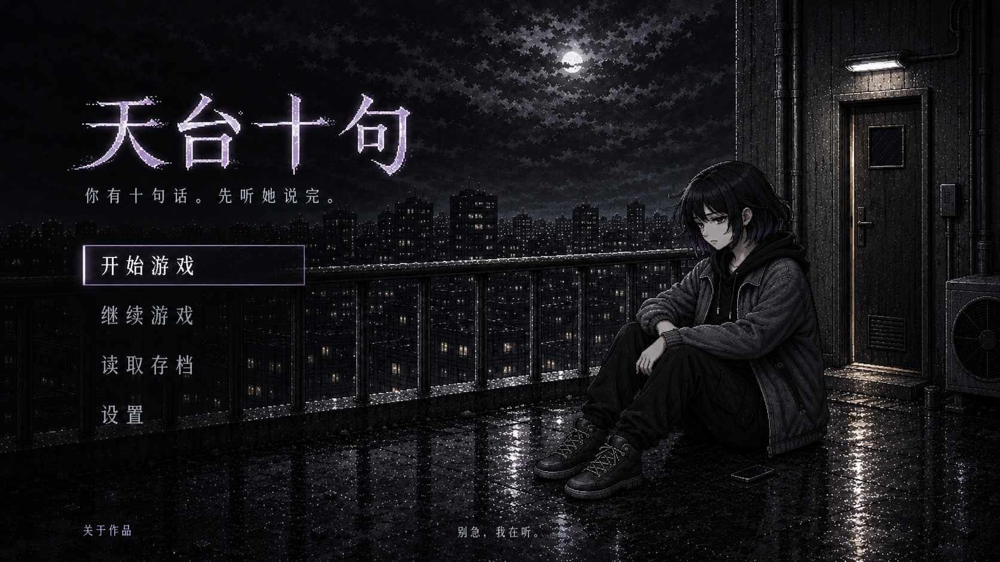

# 《天台十句》首页视觉方案：风声里的回应

日期：2026-10-29
交付类型：桌面首页设计方案与 imagegen 概念样图。首页现已按此方向接入 Vue，见 [实现与验收记录](homepage-implementation-2026-10-29/验收记录.md)。

## 1. 视觉方向与一致性依据

第一眼先看到冷夜里的四个大字，再发现天台右侧坐着的艾，最后被左下方轻亮的“开始游戏”吸引。整个首页是一幅可以进入的叙事画面。

采用电影式构图、接近黑白的冷灰色调、高细节像素叙事美术。真实感来自建筑、成年人物比例、湿地反光和克制的姿态。保留现有 CG 的清晰像素簇、阶梯轮廓与细密抖动。雾紫只用于字标和极少量交互高光。

设计依据为当前 `docs/product/game_setting_bible.md`、`docs/engineering/prompts_and_settings.md` 和已接入的 `state_guarded_1600.webp`。旧美术清单仅帮助核对发型、服装与场景空间；历史情节或道具不会覆盖当前正典。

角色锁定：成年大学生艾；下颌长度的黑色层次短发、疲惫的窄眼、偏瘦下颌；黑色连帽内搭、灰黑宽松外套、黑色工装裤和深色高帮系带鞋。画面中她坐在天台内侧的地面上，双脚落地，栏杆在身后。手臂自然搭在膝上，微侧脸，肩膀下沉。整体服装、发型和像素密度与游戏内 CG 对齐。

情绪来自人物与城市之间的距离、左侧的黑暗留白、雨后未干的地面，以及门边微弱的光。不把艾塑造成等待英雄的装饰人物，也不以危险动作制造吸引力。

## 2. 页面布局

基准画布为 1920×1080，单屏覆盖视口，主要内容保持左对齐。左侧约 42% 服务标题和操作，右侧约 58% 服务叙事场景。标题、人物与主按钮构成不等边三角关系。

| 区域 | 位置与尺寸建议 | 画面作用 |
| --- | --- | --- |
| 夜空 | 上方约 40%，云层压低，月亮被遮挡 | 提供低细节留白，建立沉静压迫感 |
| 游戏标题 | x≈180，y≈215，宽约 655，高约 140 | 四字横排，首个视觉锚点 |
| 标语 | x≈190，y≈410 | 一句短文案，与标题同一基线体系 |
| 主菜单 | x≈190，y≈535，宽 304 | 开始游戏、继续游戏、读取存档、设置 |
| 人物 | 右侧约 70%–77% 处，坐姿视觉高度约 410 | 以侧背影表达疲惫和距离，脸部保留身份线索 |
| 场景出口 | 最右侧保留天台门、墙体与管线 | 微弱门缝光为后续离开提供空间暗示 |
| 关于作品 | 左下，距底约 60–75 | 次要入口 |
| 情绪引导 | 底部居中 | “别急，我在听。” |

```text
┌──────────────────────────────────────────────────────────────────┐
│               低云、被遮住的月光                          管线    │
│                                                                  │
│     天台十句                                      天台门         │
│     你有十句话。先听她说完。                       ┃微光          │
│                         远处城市 / 栏杆            ┃              │
│     [ 开始游戏 ]                                  艾              │
│       继续游戏                                  坐在地面          │
│       读取存档                         雨后地面的细碎反光          │
│       设置                                                       │
│                                                                  │
│     关于作品                 别急，我在听。                        │
└──────────────────────────────────────────────────────────────────┘
```

标题及按钮背后的背景用局部暗化保证阅读。城市细节主要集中在中右侧，避免窗灯穿过字形。人物上方和人物与菜单之间保留距离，不增加背景简介卡片。

## 3. 色彩方案

| 名称 | 色值 | 用途 |
| --- | --- | --- |
| 深夜黑 | `#090B0E` | 基础背景、暗角、菜单后的局部遮罩 |
| 湿石墨 | `#20252C` | 地面、墙体、衣服暗部与建筑层次 |
| 冷雾灰 | `#8C96A2` | 次级文本、栏杆边缘、较暗环境光 |
| 纸月白 | `#E2E1DE` | 标题主色、主按钮文字与焦点 |
| 雾紫 | `#B3A6C7` | 标题极少量残色、主按钮的细边和悬停反馈 |
| 门隙灰白 | `#C8C3B8` | 极小面积、接近中性的门缝光与地面反射 |

环境整体保持近黑白。雾紫不扩散成大面积光晕；门缝光的面积不超过画面约 1%，亮度低于标题与主按钮，不做金色救赎光柱。正文放在稳定暗区，实际实现时校验普通文字对比度至少 4.5:1、交互边界和焦点至少 3:1。

## 4. 字体与标题

字标沿用现有 `menu_title.png` 的四字识别轮廓，整理成可独立使用的横排标题层。保留宋体式骨架、部分像素断口和干燥的边缘，减少外围装饰，让四字在缩小后仍然可读。最终生产字标应采用可编辑矢量母版或足够分辨率的透明 PNG/WebP；语义标题继续用真实的 `h1`。

1920×1080 下，标题视觉高度约 120–150 px，标语 22 px，菜单 22 px，页脚 14–16 px。标语与菜单可采用项目已有 `HanYiPixel11`，优先用 22 px 等适配字号；若小字阅读受限，页脚使用清晰的系统中文无衬线。标题的存在感靠字形、尺度和间距，不靠外发光。

实际页面里的标语、菜单及页脚必须是 HTML 文本。效果图里的文字只用于预览。

## 5. 按钮、状态与交互

主菜单纵排，入口依次为“开始游戏”“继续游戏”“读取存档”“设置”。主按钮约 304×56 px，近透明底、1 px 细边、2 px 内的小圆角或直角；其他入口为 48–56 px 高的文字按钮，纵向节奏约 58–64 px。次级入口拥有完整可点击区域。

| 状态 | 视觉与行为建议 |
| --- | --- |
| 默认 | 主按钮文字明亮、细边轻亮；其余入口为冷灰文字 |
| 悬停 | 140–180 ms 内背景亮起约 6%–8%，文字趋近纸月白，左侧短线略变亮；不缩放、不跳动 |
| 按下 | 背景短暂回暗，边框保持，给出明确但轻微的响应 |
| 键盘焦点 | 与悬停同等清晰，另有 2 px 可见轮廓，不依赖颜色差异独自传达 |
| 无有效存档 | “继续游戏”保留但禁用，显示或可获得“暂无存档”的说明；“开始游戏”保持主入口 |
| 有有效存档 | “继续游戏”恢复最近一次有效存档，按其类型进入主线或安全回访；“读取存档”展示栏位供玩家明确选择 |
| 弹窗 | 读取存档与关于作品采用同一套石墨底、细边、清晰中文排版；支持 Esc 关闭并恢复焦点 |

加载完成即可操作，所有按钮不等待动画结束。进入游戏只做约 450–700 ms 的一次渐暗转场，提供减少动态效果的静态路径。云层或远光若后续制作分层素材，可加入非常缓慢、幅度很小的变化；本次单张样图不声称具备动画。

默认静音，用户主动打开声音后才播放低音量风声和远城环境音。悬停声音可关闭，避免惊吓式提示、心跳倒计时或紧迫音效。

## 6. 背景构成

- 前景：深灰湿混凝土，少量积水映出栏杆与门边的光，不堆积物件。
- 中景：艾在右侧地面上抱膝坐着，姿态疲惫、克制；短发只有少量发梢被风吹动。手机可小而暗地反扣在身旁，不展示未发送消息或额外剧情。
- 中后景：连续金属护栏明确分隔天台与城市；人物始终在护栏内侧。保持项目里城市在左、中部，门与设备在右侧的空间关系。
- 远景：普通城市建筑、细碎灰白窗灯，不加真实地标、品牌与霓虹招牌。
- 上方：厚重低云、被遮住的月光。保留足够暗部让标题进入画面。
- 希望的线索：门缝中接近中性的微光、地面的短反射，以及愿意回应玩家操作的主按钮。

画面不出现抽烟、伤害过程、坠落、坐在护栏上等动作；角色处境通过空镜、距离与姿态呈现，与当前正典保持一致。

## 7. 标语备选

1. **你有十句话。先听她说完。** —— 推荐用于本版，简短交代机制和倾听的态度。
2. 城市很吵。她已经沉默很久。 —— 更偏电影海报的情绪张力。
3. 有些沉默，是还没说出口的求助。 —— 更直接点出作品主题。
4. 这一夜，先别急着给答案。 —— 强调克制和非说教的回应。
5. 风声很大。她的声音很轻。 —— 和雨夜天台的声音意象结合。

底部引导统一使用：**别急，我在听。**

## 8. 完整方案画面描述

打开网页，首先迎来的是一整片雨后发冷的夜色。低云压在城市上空，月亮只露出一块被云磨暗的灰白。左侧留出大面积安静的黑，四个略有像素断口的字——“天台十句”——悬在这片暗处，灰白里只有一点旧雾紫的痕迹。标题下面是一行细小但清楚的话：“你有十句话。先听她说完。”

视线往右移动，才看见艾。她穿着熟悉的灰黑外套和连帽内搭，短发贴着脸侧，坐在天台地面上，手臂搭在膝头。身后的护栏隔开她和密集的城市。远处许多窗户仍亮着，她所在的位置却很静。最右侧是原有的门与设备墙，门缝透出很窄的一点灰白光，在潮湿地面留下一小段反射。

左下方的“开始游戏”亮得刚好能被看到。它被一条细框轻轻托住，下面是更安静的“继续游戏”“读取存档”和“设置”。鼠标移上去，按钮只亮一点，让玩家知道自己的动作被回应了。屏幕底部只剩一句：“别急，我在听。”

首页的吸引力来自从远处城市到近处人物、从沉默到回应的视线变化。镜头始终与艾保持距离，让她拥有自己的空间。

## 9. 网页落地约束与交付

建议拆为背景场景、局部暗化层、透明标题层、HTML 操作层四层。背景使用桌面横图，手机端另取以艾和门为重点的竖向裁切，配合真实文字重新布局；不要把整张样图直接缩成手机网页。移动端按钮至少 48 px 高，保留标题、人物与主按钮的首屏可见性，必要时允许短屏滚动。

设计阶段 imagegen 生成的完整桌面首页样图用于构图与色彩确认。实现阶段已在 `StartView.vue` 接入无字场景背景、现有字标的四字视窗与真实 HTML 按钮，详见实现与验收记录。

生成工具：内置 imagegen / GPT 图像工具。完整生成提示词见同目录 `homepage-2026-10-29.imagegen-prompt.txt`。

生成参考：

- `legacy_vue/public/assets/images/unified_image2_2026-07-31/game_cg/state/state_guarded_1600.webp`：艾的身份、服装、像素风格和天台空间。
- `legacy_vue/public/assets/images/menu_title.png`：四字标题轮廓与品牌识别。

最终样图已保存至：`legacy_vue/public/assets/images/homepage_concepts/2026-10-29/tiantai-shiju-home-v1.png`。

文件实际规格为 1672×941 PNG，约 2.45 MiB；布局标注使用 1920×1080 作为参考画布，并未把概念图放大后声称是原生 1920×1080 输出。复制后的文件与 imagegen 原始输出 SHA-256 一致。

视觉检查：标题、标语、四个主菜单入口、关于作品及底部短句均可读；保留成年短发艾、黑色连帽内搭、灰黑外套、工装裤、高帮鞋和坐在地面的姿态。画面使用近黑白像素细节、极少量标题雾紫，护栏位于人物身后，右侧门与设备墙位置一致。生成稿将希望的光主要表现为门上方的小灯与门边反光，属于同一构图方向的视觉演绎。


