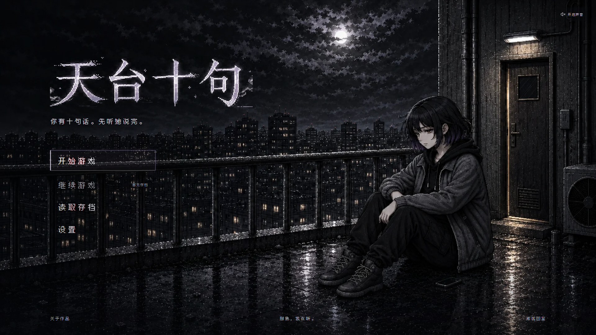
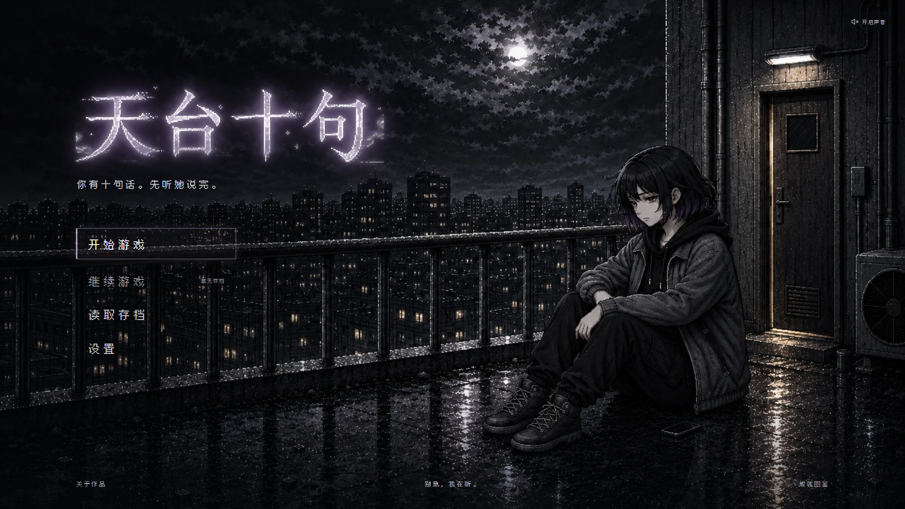
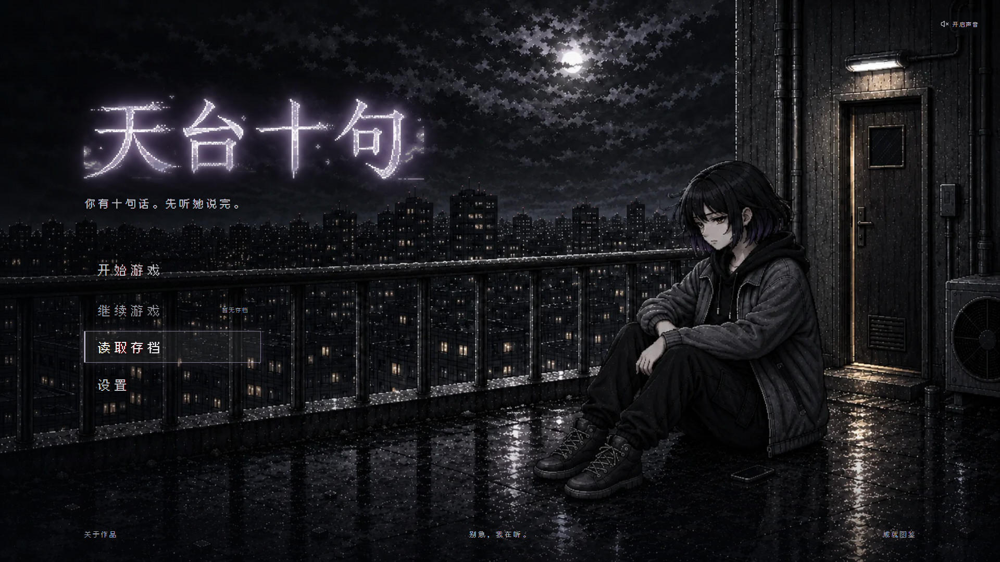
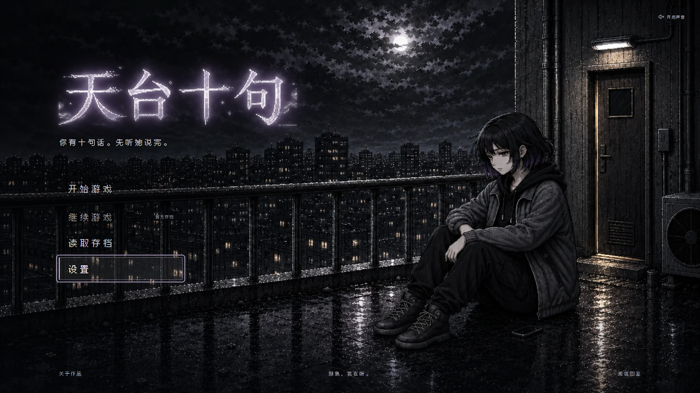
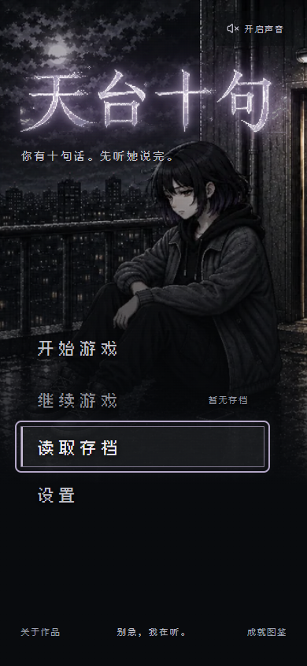

# 首页标题柔光与菜单选中状态修复

日期：2026-10-29

## 修复结果

1. 标题增加三层由近到远的灰紫柔光，保持字形清晰。柔光放在外层 `.game-title`，内部 `.title-window` 继续只裁切字标，避免把向外扩散的光晕一并切掉。未生成或替换美术资产。
2. 将菜单亮边、左侧标记和光晕从固定的 `.menu-button-primary` 移至唯一的 `.is-selected` 状态。鼠标移动、悬停或键盘焦点进入菜单时更新选中项；开始游戏保留默认选中，但其他项选中后不再留着开始游戏的亮边。
3. 支持 Tab / Shift+Tab、上下方向键循环、Home / End；跳过无存档时禁用的继续游戏。若选中的继续游戏对应存档失效，选中态回到开始游戏。弹窗关闭后恢复焦点与选中态。

## 自动化验证

- `npm test -- --run`：18 个测试文件、136 项测试通过。
- 新增 5 项首页回归测试：鼠标移动唯一选中态、禁用项不抢占、键盘与鼠标交替、方向键循环及 Home / End、有存档的继续入口与失效回退。
- `npm run lint`：通过。
- `npm run build`：Vue / TypeScript 与 Vite 生产构建通过。
- `git diff --check -- legacy_vue/src/views/StartView.vue legacy_vue/tests/StartView.test.ts`：通过。

## 浏览器验证

使用独立的 agent-browser Chrome 会话访问本地 Vite 服务 `http://127.0.0.1:5173/`。未触碰用户浏览器数据。

- 默认、读取存档悬停、设置悬停，以及鼠标回到开始游戏时均仅存在一个选中项。
- 读取存档选中后，“开始游戏”的实际计算样式 `box-shadow` 为 `none`。
- 禁用的继续游戏不会接管选中态；上下键跳过它，支持循环与 Home / End。
- 实际 Tab / Shift+Tab 检查焦点与选中态同步；Enter 激活设置并进入 `/settings`。
- 鼠标与键盘交替输入时，选中态随新的输入方式切换。
- 读取存档弹窗可打开，Esc 后焦点与选中态回到读取存档。
- 在 1920×1080、390×844、320×568、667×375 检查标题柔光与菜单状态，图片正常加载，无横向溢出。桌面、手机与横屏截图已目视检查。
- 减少动态效果模式下，按钮过渡时长为 `0s`。
- 浏览器未报告 JavaScript 异常。

14 个状态快照及计算样式见 [browser-verification.json](browser-verification.json)。

## 截图

修复前：

修复后默认状态：

鼠标选中读取存档：

键盘选中设置：

手机：

