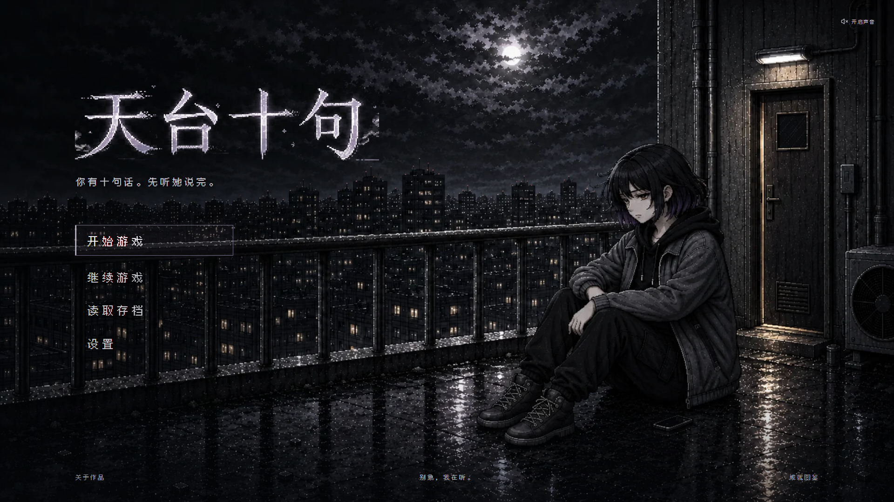
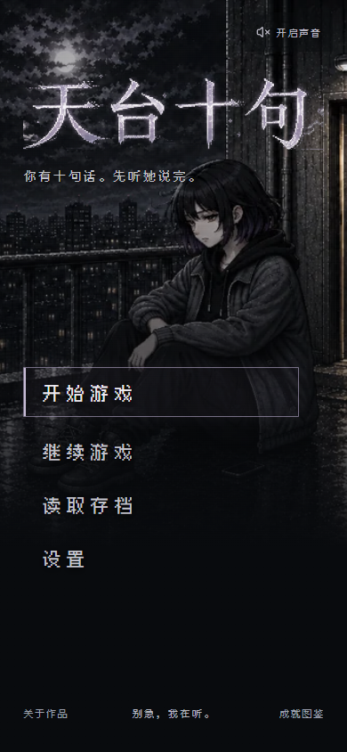
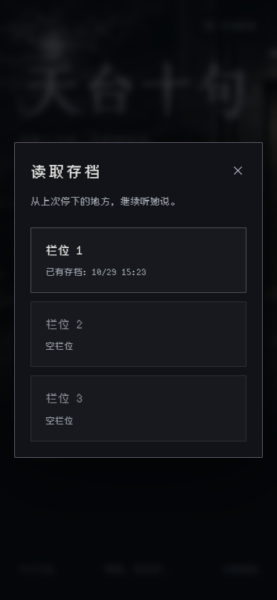

# 《天台十句》首页实现与验收

日期：2026-10-29
实现入口：`legacy_vue/src/views/StartView.vue`
设计依据：[首页视觉方案](../homepage-2026-10-29.md)

## 实现结果

首页采用左侧标题与纵向菜单、右侧艾与天台门的构图。保留当前成年短发艾、黑色连帽内搭、灰黑外套、裤装和高帮鞋，以及坐在天台实地上的姿态。环境为雨后近黑白像素夜景，雾紫只用于字标与交互细节。

标题复用现有 `menu_title.webp` 的四字部分，使用 CSS 视窗裁切隐藏外围装饰及英文副标题；图片加载前显示真实文字占位，WebP 失败后尝试原 PNG。标语、菜单、页脚均为真实 HTML 文本。

主菜单为“开始游戏 / 继续游戏 / 读取存档 / 设置”。“关于作品”与保留的“成就图鉴”放在页脚。原首页的长介绍移入关于弹窗。

- 开始游戏：重置本轮状态并以 `entry=new` 进入，保留已有存档。
- 继续游戏：按时间选择最近的有效存档。主线以 `entry=load` 恢复，安全回访通过 `slot` 参数进入相应场景。
- 无有效存档：“继续游戏”禁用，给出“暂无存档”的可见与辅助说明。
- 读取存档：保留三个栏位，显示时间与类型，空栏位和不可用栏位禁用。读取过程中失效的存档显示弹窗内错误。
- 存档可用性检查：只读检查元数据、CRC 与必要结构，不恢复游戏、不删除文件、不改变存档格式。
- 弹窗：采用原生 `dialog`，支持键盘焦点约束、Esc、关闭按钮、背景关闭以及返回触发按钮的焦点。
- 首次打开首页不自动请求背景音乐；原声音按钮可主动开启。游戏内原有音频流程保留。
- 支持键盘焦点、触摸目标、减少动态效果偏好；短屏使用首页内部滚动。

## 图像来源与导出

生产场景使用内置 imagegen / GPT 图像工具，以已确认的概念样图为参考，清除全部标题、菜单和页脚，保持其人物、光照、镜位与场景。最终标题复用项目原字标。

- 完整提示词：[背景生成提示词](../homepage-2026-10-29.background.imagegen-prompt.txt)
- 原始无字图：`legacy_vue/public/assets/images/homepage_20261029/rooftop-source.png`，1672×941。
- 桌面 WebP：`rooftop-1672.webp`，248,242 字节，约 242.4 KiB。
- 手机 WebP：`rooftop-960.webp`，107,052 字节，约 104.5 KiB。
- 可复现导出：在 `legacy_vue/` 执行 `npm run assets:homepage`。

## 自动化检查

- `npm test -- --run`：16 个文件、122 项测试通过。
- 新增首页回归覆盖：无存档、最近有效主线、较新损坏记录回退、安全回访入口、明确选择旧栏位、弹窗期间存档失效、回到页面刷新状态、Esc 及焦点返回、开始新游戏保留旧存档。
- 音频回归覆盖静默初始化与主动开启。
- 更新旧首页相关测试的菜单与弹窗预期，保留开场和读档流程覆盖；jsdom 的原生弹窗能力通过最小 stub 模拟，真实焦点行为另外在浏览器检查。
- `npm run lint`：通过。
- `npm run build`：Vue / TypeScript 检查与 Vite 生产打包通过。
- `git diff --check`：通过。

## 浏览器验收

使用隔离的 agent-browser Chrome 会话访问 `http://127.0.0.1:5173/`，未使用或更改用户原浏览器存档。

| 视口 | 横向溢出 | 主按钮首屏可见 | 交互目标至少 44×44 | 图片与字体加载 |
| --- | --- | --- | --- | --- |
| 1920×1080 | 无 | 是 | 是 | 正常 |
| 1366×768 | 无 | 是 | 是 | 正常 |
| 768×1024 | 无 | 是 | 是 | 正常 |
| 390×844 | 无 | 是 | 是 | 正常 |
| 320×568 | 无 | 是 | 是 | 正常，页内可滚动 |
| 844×390 | 无 | 是 | 是 | 正常，页内可滚动 |
| 667×375 | 无 | 是 | 是 | 正常，页内可滚动 |
| 2560×1080 | 无 | 是 | 是 | 正常 |

结构测量结果见 [layout-verification.json](layout-verification.json)。已目视检查桌面、手机、小屏与横屏截图；短手机提高场景最小高度，避免标语遮住艾的脸；窄横屏采用紧凑布局。

实际操作已完成：开始新游戏 → 跳过序章 → 在栏位 1 保存 → 返回首页 → 继续游戏。浏览器实际进入 `/game?entry=load`，直接恢复对话，不重播序章。设置与成就图鉴均已点击进入并返回首页。关于弹窗经 Tab / Esc 验证焦点返回原入口；读取存档弹窗展示真实保存的测试栏位。

自动无障碍检查使用 axe-core 4.12.1 的 WCAG 2 A/AA 标签：桌面首页 15 项规则通过、0 项违规、1 项图片叠层下的文字对比度需人工判断；存档弹窗 12 项规则通过、0 项违规、无待判断项。背景上的文字另经实际截图目视检查。原始首页检查见 [accessibility-audit.json](accessibility-audit.json)。该检查记录不等同于完整的无障碍认证。

浏览器流程未向 AI 模型发送对话请求。主线与安全回访存档的路由分派、损坏存档处理等以自动化回归进一步覆盖。

## 实际运行截图

桌面：

手机：

读取存档：

