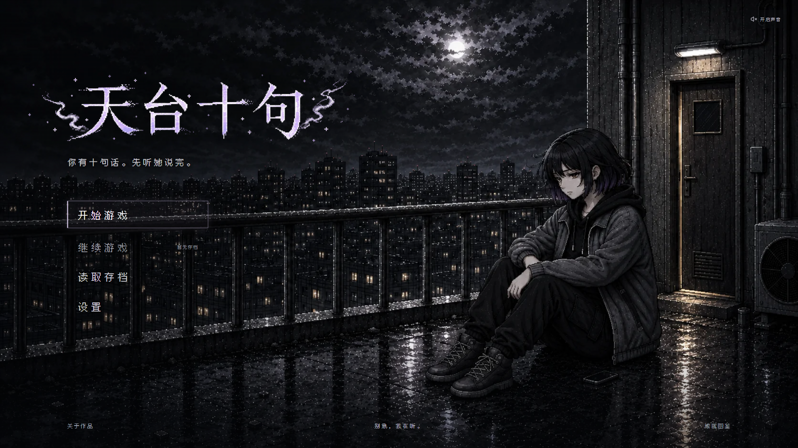
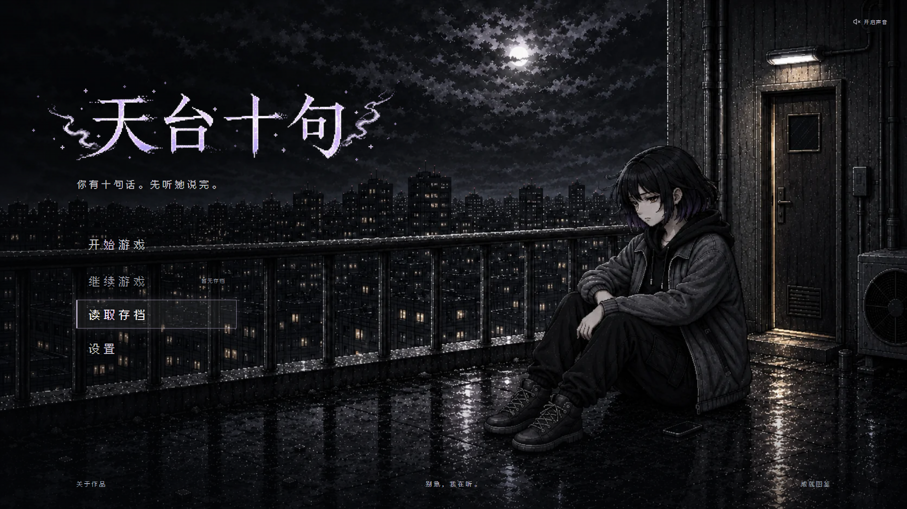
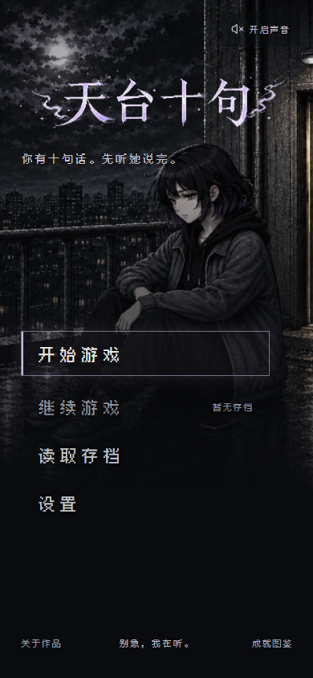
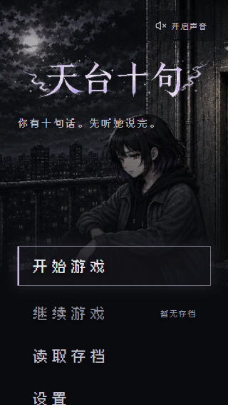
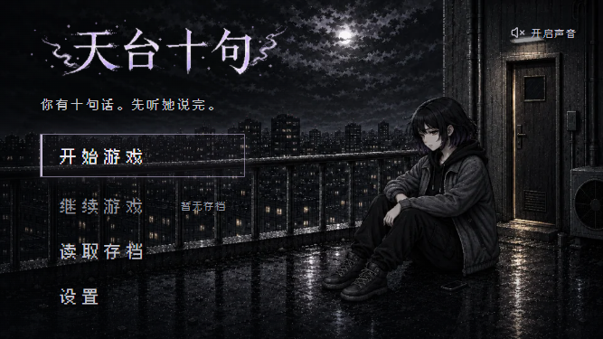

# 已审核标题素材接入

日期：2026-10-29

## 接入范围

使用用户确认的 `docs/design/title-review-2026-10-29/title-original-expanded-v1.png`，没有重新生成或修改其画面内容。菜单选中状态、鼠标与键盘导航、存档与关于弹窗等既有改进保留。

生产文件：

- `legacy_vue/public/assets/images/homepage_20261029/title-expanded-v1.png`：2172×724，复制后 SHA-256 与审核原图一致。
- `legacy_vue/public/assets/images/homepage_20261029/title-expanded-v1.webp`：2172×724，339,846 字节，无损导出。

对 PNG 与 WebP 解码后的像素逐一比较：透明度差异 0 个像素，可见颜色差异 0 个像素。原 PNG 同时作为 WebP 加载失败时的回退资源。

## 页面调整

- 首页改为加载上述已审核素材。
- 标题图使用完整画布，移除原来对旧标题进行裁切的 `overflow: hidden`；保留粒子与透明边距。
- 取消旧素材的额外颜色滤镜，没有增加外发光。
- 桌面、手机与短横屏分别缩放和定位完整素材，保持既有标语、菜单及人物布局。
- 更新 `npm run assets:homepage`，可重复生成无损标题 WebP。

实现位置：`legacy_vue/src/views/StartView.vue`、`legacy_vue/scripts/generate_homepage_assets.mjs`。

## 验证

- `npm test -- --run`：18 个文件、136 项测试全部通过。
- `npm run lint`：通过。
- `npm run build`：Vue / TypeScript 与 Vite 生产构建通过。
- `git diff --check -- src/views/StartView.vue scripts/generate_homepage_assets.mjs`：通过。
- 浏览器未报告 JavaScript 异常。

浏览器在以下 7 种视口检查素材加载、裁切样式、可见粒子范围与标语间距，以及横向溢出：1920×1080、1366×768、768×1024、390×844、320×568、667×375、2560×1080。全部通过。粒子范围依据原 PNG 中 alpha≥16 的像素包围盒计算，另已目视检查桌面、手机、小屏与横屏截图。

标题内外层计算样式 `filter` 均为 `none`，标题容器 `overflow` 为 `visible`。实际检查数据见 [layout-verification.json](layout-verification.json)。

菜单交互复查：鼠标移到读取存档时，唯一选中项为 `load`，开始游戏的 `box-shadow` 为 `none`；方向键跳过禁用的继续游戏并同步焦点；打开存档弹窗后按 Esc，焦点恢复到读取存档。以上均通过。

## 实际运行截图

桌面：

桌面菜单移动：

手机：

小屏：

横屏：

